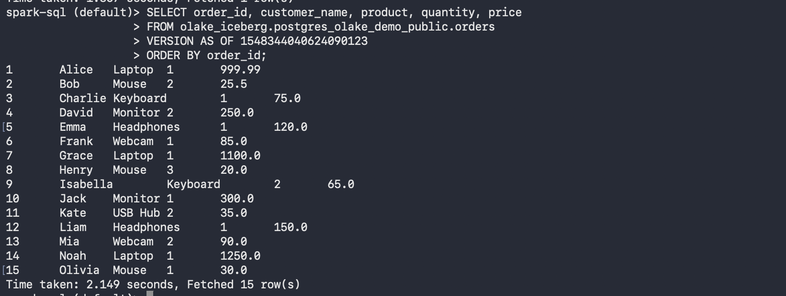
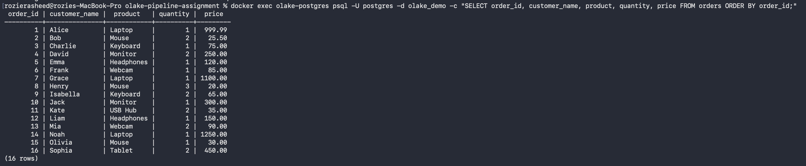
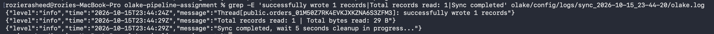
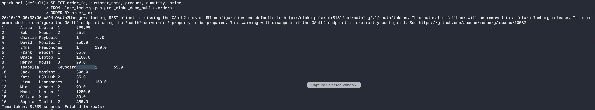

## Architecture

This project demonstrates a complete data pipeline, starting with data stored in a PostgreSQL database and ending with that same data being queried through Apache Spark.

```text
                       SOURCE DATABASE
                     ┌─────────────────┐
                     │   PostgreSQL    │
                     │  orders table   │
                     │    15 rows      │
                     └────────┬────────┘
                              │
                              │ Reads data and captures changes
                              ▼
                     ┌─────────────────┐
                     │      OLake      │
                     │ Schema discovery│
                     │ Data sync + CDC │
                     └────────┬────────┘
                              │
                              │ Writes Iceberg tables
                              ▼
          ┌─────────────────────────────────────┐
          │         APACHE ICEBERG              │
          │      Analytical table format       │
          └─────────────────────────────────────┘
                    │                  │
                    ▼                  ▼
          ┌────────────────┐  ┌────────────────┐
          │ Apache Polaris │  │     MinIO      │
          │  REST Catalog  │  │  Object Storage│
          │ Table metadata │  │   Data files   │
          └────────────────┘  └────────────────┘
                    │                  │
                    └────────┬─────────┘
                             ▼
                     ┌─────────────────┐
                     │  Apache Spark   │
                     │    Spark SQL    │
                     │ Query and verify│
                     └─────────────────┘
```

### 1. PostgreSQL: Source Database

PostgreSQL is where the original data lives.

In this project, PostgreSQL runs inside a Docker container and stores a table named `orders`, initially containing 15 fictional customer orders.

Each record contains information such as an order ID, customer name, product, quantity, and price.

**When it is used:** At the beginning of the pipeline, as the source of data. It is also used later to demonstrate CDC by inserting a new record.

### 2. OLake: Data Ingestion and Synchronization

OLake is the main component connecting the source database to the destination data lake.

It performs three important tasks:

- **Schema discovery:** Identifies available PostgreSQL tables and their columns so OLake knows what data it can ingest.
- **Initial synchronization:** Reads the existing records from PostgreSQL and writes them into Apache Iceberg.
- **Change Data Capture (CDC):** Uses PostgreSQL's logical replication capabilities to identify changes made after the initial synchronization.

**When it is used:** After PostgreSQL is initialized and the Iceberg destination is configured. OLake runs once for the initial data transfer and again when new changes need to be synchronized.

**Why it matters:** Rather than writing a custom extraction and loading application, a data engineer can use OLake to handle much of the ingestion process.

### 3. Apache Iceberg: Analytical Table Format

Apache Iceberg is an open table format designed for large analytical datasets.

It organizes data files and metadata so engines such as Apache Spark can reliably query tables. Iceberg also supports features such as snapshots, schema evolution, and transactional table updates.

Iceberg is not a standalone database server. It defines how analytical tables are stored and managed.

**When it is used:** OLake writes the synchronized records as an Iceberg table. Spark later reads that same table.

### 4. Apache Polaris: REST Catalog

Apache Polaris acts as the catalog for the Iceberg tables.

A catalog helps data engines find tables and access their metadata. Polaris exposes a REST API that both OLake and Spark can use.

For this project, the catalog is named `olake_catalog`.

**When it is used:** During OLake synchronization to create and update Iceberg tables, and during Spark queries to locate and read those tables.

**Why it matters:** OLake and Spark can work with the same Iceberg tables through a shared catalog, without requiring either application to manage the catalog independently.

### 5. MinIO: Object Storage

MinIO provides S3-compatible object storage running locally through Docker.

In this project, Iceberg data and metadata files are stored in the `iceberg-warehouse` bucket.

The warehouse location is:

`s3://iceberg-warehouse`

**When it is used:** Whenever OLake writes Iceberg files and whenever Spark reads the stored data.

**Why it matters:** It allows the project to demonstrate an S3-style data lake without requiring an AWS account.

### 6. Apache Spark: Query and Verification

Apache Spark is the processing and analytics engine used to read the final Iceberg table.

Spark connects to the Polaris REST catalog, locates the table, and reads its underlying files from MinIO.

Using Spark SQL, we can verify that the data successfully moved from PostgreSQL into Iceberg.

**When it is used:** After the initial OLake synchronization and again after CDC synchronization.

The main verification query is:

```sql
SELECT COUNT(*)
FROM olake_iceberg.postgres_olake_demo_public.orders;
```

The initial query returned 15 rows. After inserting an additional PostgreSQL record and synchronizing again, the result increased to 16.

### End-to-End Data Flow

1. PostgreSQL stores the original 15 customer orders.
2. OLake discovers the `public.orders` table and its columns.
3. OLake reads the records and writes them into an Iceberg table.
4. Polaris manages the catalog metadata, while MinIO stores the underlying Iceberg files.
5. Spark connects through Polaris and queries the Iceberg data stored in MinIO.
6. A new order is inserted into PostgreSQL.
7. OLake synchronizes the change through CDC.
8. Spark queries the updated Iceberg table and confirms that all 16 records are available.

The result is a local data pipeline that demonstrates both initial data ingestion and incremental synchronization.

## Gotchas and Troubleshooting

Building this pipeline involved several challenges related to Docker, catalog configuration, authentication, and data synchronization.

### 1. Docker Was Not Initially Installed

**Problem:** Running `docker --version` returned `command not found`.

**Cause:** Docker Desktop had not been installed on the Mac.

**Solution:** Installed the Intel-compatible version of Docker Desktop, moved it to Applications, and started Docker before creating the containers.

**Takeaway:** Verify that Docker Desktop is installed and running before beginning the setup.

### 2. Connecting Services Across Docker Containers

**Problem:** PostgreSQL, OLake, Polaris, MinIO, and Spark needed to communicate with one another even though they were running in separate containers.

**Solution:** Used a shared Docker network named `olake-network`.

Within this network, services can connect using container hostnames, such as:

- `olake-postgres`
- `olake-polaris`
- `olake-minio`

**Takeaway:** Inside Docker, `localhost` refers to the current container, not the host machine or another container. Use the appropriate container hostname when configuring connections.

### 3. Configuring Apache Polaris Authentication

**Problem:** Connecting OLake and Spark to the REST catalog required more than simply starting the Polaris container.

**Cause:** Polaris requires a configured catalog, appropriate roles, and valid credentials for API access.

**Solution:** Configured the `olake_catalog` catalog, the `olake_user` principal, and the required role permissions. Used OAuth credentials to authenticate clients to Polaris.

**Takeaway:** Make sure catalog creation, authentication, and permissions are configured before attempting to synchronize data.

### 4. Connecting Iceberg to MinIO

**Problem:** The Iceberg catalog needed to reference object storage that was accessible from the Docker network.

**Solution:** Configured the warehouse location as `s3://iceberg-warehouse`, using the internal MinIO endpoint `http://olake-minio:9000`.

Also configured the appropriate storage credentials, AWS region, and S3 path-style access.

**Takeaway:** The REST catalog and object storage are separate components. A working catalog connection does not automatically mean the data files are accessible.

### 5. Spark Requires Additional Iceberg Dependencies

**Problem:** Spark does not automatically include everything needed to access an Iceberg REST catalog backed by S3-compatible storage.

**Solution:** Launched Spark with the Iceberg Spark runtime and AWS bundle dependencies:

```text
org.apache.iceberg:iceberg-spark-runtime-3.5_2.12:1.10.2
org.apache.iceberg:iceberg-aws-bundle:1.10.2
```

**Takeaway:** Match the Iceberg runtime to the Spark version and configure the catalog and storage access before running SQL queries.

### 6. CDC Requires PostgreSQL Logical Replication

**Problem:** Synchronizing changes after the initial load requires PostgreSQL to expose database changes to the ingestion tool.

**Solution:** Configured PostgreSQL logical replication and used a publication and replication slot for OLake.

The tested environment used:

- Publication: `olake_publication`
- Replication slot: `olake_replication_slot`

After inserting a new order, OLake successfully synchronized one additional record.

**Takeaway:** CDC requires database-side preparation and synchronization state. It is different from repeatedly copying the entire source table.

### 7. Avoiding Duplicate Sample Records

**Problem:** Re-running the database initialization script against an existing database can insert the original sample records again.

**Solution:** Run `postgres/init.sql` only when initializing a fresh database.

**Takeaway:** Initialization scripts should ideally be idempotent, meaning they can safely be run multiple times. For this demonstration, the script should only be executed once.

### 8. Keeping Credentials Out of GitHub

**Problem:** Source connections, destination settings, and Spark configurations contain passwords or access credentials.

**Solution:** Added sensitive configuration files to `.gitignore` and committed `.env.example` with placeholder values instead of actual secrets.

**Takeaway:** Public repositories should contain safe configuration templates, not real passwords, tokens, or client secrets.

### 9. Rebuilding the Local MinIO Image

**Problem:** The current Docker Compose file uses a locally built image named `olake-minio-local:latest`. This image is available on the development machine but is not automatically available to someone cloning the repository.

**Cause:** The Dockerfile expects MinIO source files that are not included in the repository.

**Current status:** The local pipeline runs with the existing image, but a fresh installation needs an additional image-build step or an updated Compose configuration using an obtainable image.

**Takeaway:** A successful local demonstration is not necessarily a reproducible public tutorial. Image availability, setup scripts, and configuration templates must also be considered.

## Pipeline Verification and Screenshots

The following screenshots document the successful PostgreSQL → OLake → Apache Iceberg pipeline, including the initial synchronization and subsequent Change Data Capture (CDC).

### Screenshot 1: Initial Synchronization (15 Orders)

**Description:** OLake successfully synchronized the original 15 customer orders from PostgreSQL into Apache Iceberg. Apache Spark SQL queries the initial Iceberg snapshot to verify that all 15 records were transferred correctly.

**Spark SQL query:**

```sql
SELECT order_id, customer_name, product, quantity, price
FROM olake_iceberg.postgres_olake_demo_public.orders
VERSION AS OF 1548344040624090123
ORDER BY order_id;
```

**Result:** 15 rows returned, matching the original PostgreSQL dataset.



### Screenshot 2: New Order Inserted into PostgreSQL

**Description:** A new customer order is inserted into the PostgreSQL source table. This brings the source dataset from 15 to 16 records and provides a change for OLake to capture through CDC.

**PostgreSQL verification query:**

```sql
SELECT order_id, customer_name, product, quantity, price
FROM orders
ORDER BY order_id;
```

**Result:** PostgreSQL contains 16 orders, including the newly inserted order for Sophia.



Screenshot 3: OLake CDC Synchronization

**Description:** OLake performs another synchronization using PostgreSQL's logical replication and the saved synchronization state. The new order is captured and written into Apache Iceberg, producing an updated table snapshot.

**Result:** OLake successfully processes the new record and completes synchronization.



### Screenshot 4: Spark Verification After CDC (16 Orders)

**Description:** Apache Spark queries the latest Iceberg table snapshot after OLake's incremental synchronization. The updated table now contains all 16 orders, demonstrating that the PostgreSQL change reached the Iceberg destination.

**Spark SQL query:**

```sql
SELECT order_id, customer_name, product, quantity, price
FROM olake_iceberg.postgres_olake_demo_public.orders
ORDER BY order_id;
```

**Result:** 16 rows returned, including Sophia's new order.



### Verification Summary

| Stage                     | PostgreSQL Records | Iceberg Records | Outcome                               |
| ------------------------- | -----------------: | --------------: | ------------------------------------- |
| Initial synchronization   |                 15 |              15 | Successful                            |
| New order inserted        |                 16 |              15 | Source change pending synchronization |
| OLake CDC synchronization |                 16 |              16 | Successful                            |
| Final Spark verification  |                 16 |              16 | Data matches                          |

These results demonstrate that OLake can perform both initial data ingestion and incremental synchronization into Apache Iceberg, with Apache Spark independently verifying the resulting data.
